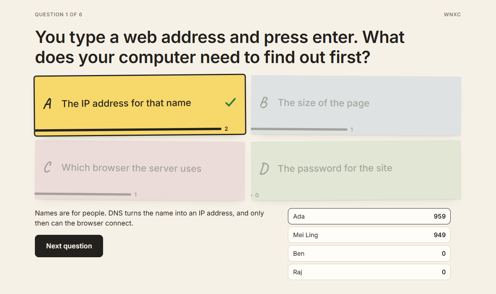

# Quizdrop

Drop in your lecture slides and get a live quiz the whole class can join from their phones.

I study by turning slides into questions, and it works better with other people in the room. So this takes a PDF or PowerPoint, writes the questions, and runs them as a timed game. One screen shows the question, everyone answers on their phone, and there's a leaderboard after each one.




<p>
  
  
</p>

## How it works

1. You drop a PDF or .pptx on the page. The text is pulled out in your browser, so the file itself never gets uploaded.
2. The text goes to the server, which asks Claude for questions and gets them back as structured JSON.
3. You read through them, fix or bin what you don't like, and open a room.
4. Players go to the site, type the four-letter code and a name.
5. The server runs the game over WebSockets. It keeps the clock and the scores.

Faster answers score more (500 to 1000 points), and a run of right answers adds a small bonus.

## Things I cared about

**The server is the only one who knows the answer.** While a question is open, nothing sent to a phone or the big screen includes the correct option. It only goes out with the reveal. There's a test that checks this by searching everything the server would send.

**The rules are plain functions.** `server/game.js` has no sockets, timers or clock in it. Every function takes the current time as an argument, which is why the tests can play a whole game in a few milliseconds. `server/index.js` is the thin part that wires those rules to real connections.

**Phones drop off wifi.** Each player gets a private key when they join. If their phone sleeps or the page refreshes, it rejoins with that key and carries on with the same score. A player who leaves doesn't hold up the question for everyone else.

**Questions get checked before they're used.** Whatever comes back from the model goes through the same validation as anything a person types in. The options also get shuffled, because models like putting the right answer in the same slot.

## Run it

Needs Node 22 or newer.

```bash
npm install
cp .env.example .env   # add your Anthropic API key
npm run dev
```

Open http://localhost:5173. Phones on the same wifi can join at your computer's IP address on port 5173.

Without an API key everything still works except writing questions from slides. There's a sample quiz built in for that.

```bash
npm test        # game rules and the question writer
npm run build   # build the client
npm start       # serve the built client and the game from one port (3001)
```

## Deploying

It needs a host that keeps a process running, because of the WebSockets. That rules out serverless platforms. `render.yaml` sets it up as one web service on Render. Set `ANTHROPIC_API_KEY` there.

Rooms live in memory. That keeps it simple, but it means one server only, and a restart ends any games in progress.

## What's in here

```
server/game.js       the rules: joining, answering, scoring, what each side can see
server/index.js      HTTP routes, WebSockets, timers, rate limits
server/generate.js   slides text in, checked questions out
src/extract.js       reads PDF and PowerPoint text in the browser
src/Host.jsx         the big screen
src/Player.jsx       the phone
```

## Not done yet

- Slides that are only images have no text to read.
- No accounts and no saved quizzes. A quiz lasts as long as the tab does.
- One answer type, four options.

MIT licensed.
