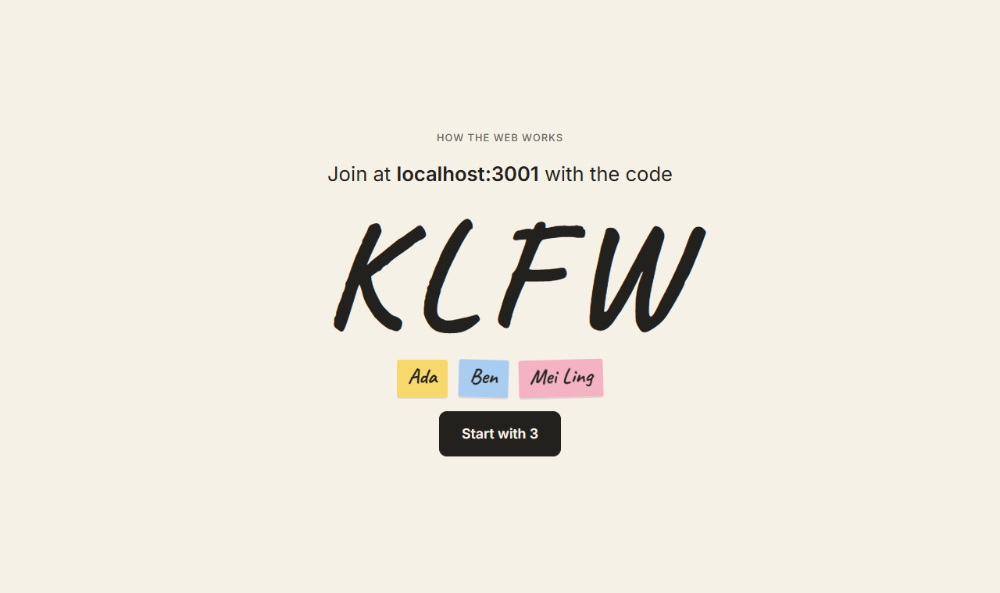
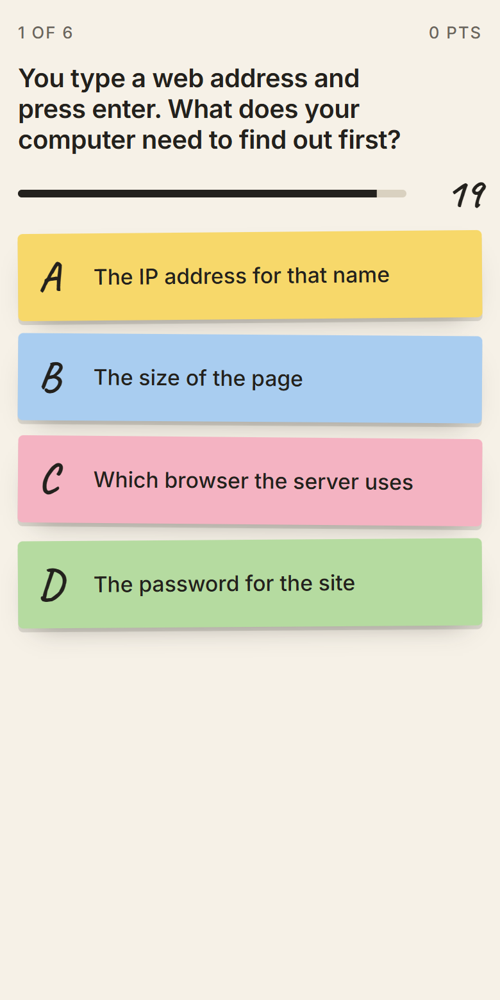
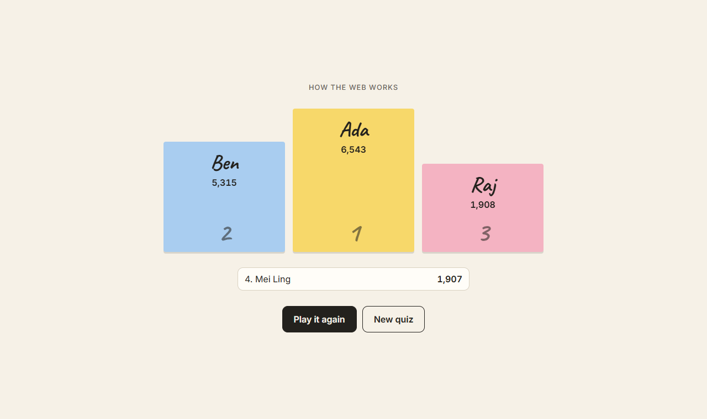

# Quizdrop

Drop in your lecture slides and get a live quiz the whole class can join from their phones.

Try it: https://quizdrop-gamma.vercel.app

I study by turning slides into questions, and it works better with other people in the room. So this takes a PDF or PowerPoint, writes the questions, and runs them as a timed game. One screen shows the question, everyone answers on their phone, and there's a leaderboard after each one.




<p>
  
  
</p>

## How it works

1. You drop a PDF or .pptx on the page. The text is pulled out in your browser, so the file itself never gets uploaded.
2. The text goes to the server, which asks Claude for questions and gets them back as structured JSON.
3. You read through them, fix or bin what you don't like, and open a room.
4. Players go to the site, type the four-letter code and a name.
5. Every screen asks the server for the current state about once a second.

Faster answers score more (500 to 1000 points), and a run of right answers adds a small bonus.

## Things I cared about

**It runs on serverless functions, so nothing lives in memory.** There's no process to hold a room or run a timer. A room is a handful of stored facts in Redis: who joined, who answered what and when, which question the host is on. The phase, the countdown and the scores are all worked out from those facts and the current time, on every request. A question doesn't get closed by a timer. It's simply closed once the time says so.

**Two people acting at once can't break a room.** Each kind of write is a single atomic operation. An answer is written once and never changed. A name is reserved with a set-if-absent, so two people can't both get it. Only the host moves the game forward, and each move says which question it came from, so a double click can't skip one.

**The server is the only one who knows the answer.** While a question is open, nothing sent to a phone or the big screen includes the correct option. There's a test that checks this by searching everything the server sends.

**Checking once a second is slow, so the clock waits.** Each question starts with a three second count-in. By the time the clock starts, every phone already has the question, so nobody loses time to a slow connection.

**The rules are plain functions.** `server/game.js` doesn't touch the database or the clock. Every function takes the room and the current time. The tests play whole games through the real API with a fake clock, in about a second.

**Phones drop off wifi.** Each player gets a private key when they join. If their phone sleeps or the page refreshes, it carries on with the same score. A player who goes quiet doesn't hold up the question for everyone else.

**Questions get checked before they're used.** Whatever comes back from the model goes through the same validation as anything a person types in. The options also get shuffled, because models like putting the right answer in the same slot. Writing questions is rate limited per person, with a daily cap for the whole site.

## Run it

Needs Node 22 or newer.

```bash
npm install
cp .env.example .env   # add your Anthropic API key
npm run dev
```

Open http://localhost:5173. Phones on the same wifi can join at your computer's IP address on port 5173.

Locally, rooms are kept in memory, so there's no database to set up. Without an API key everything still works except writing questions from slides. There's a sample quiz built in for that.

```bash
npm test        # plays games through the API, and checks the question writer
npm run build   # build the client
npm start       # serve the built client and the API from one port (3001)
```

## Deploying

It's set up for Vercel. The client is a static Vite build and `api/index.js` is the one function behind it. It needs two things:

- An Upstash Redis database (Vercel's Storage tab adds one and sets the variables for you).
- `ANTHROPIC_API_KEY` in the project's environment variables.

## What's in here

```
server/game.js       the rules: phases, scoring, what each side can see
server/app.js        the HTTP API
server/store.js      Redis on Vercel, memory locally
server/generate.js   slides text in, checked questions out
api/index.js         entry point for Vercel
src/extract.js       reads PDF and PowerPoint text in the browser
src/Host.jsx         the big screen
src/Player.jsx       the phone
```

## Not done yet

- Slides that are only images have no text to read.
- No accounts and no saved quizzes. A quiz lasts as long as the tab does.
- One answer type, four options.

MIT licensed.
